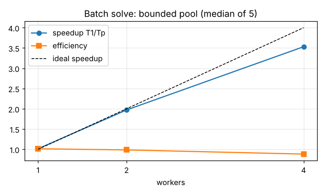

# Task D: serial vs parallel batch performance

## Method
* Workload: 20,000 independent 1-D rod cases x 500 elements each; generated by a portable splitmix64 generator with fixed seed **20260101** (identical on every platform).
* Serial baseline T1 = single thread. Parallel = bounded pool (1, 2, 4 workers, never above logical CPUs), chunked atomic work distribution, per-worker workspaces.
* 1 warm-up run (discarded), **5 measured repetitions**, **median** reported. Pool threads are created outside the timed region. Launch-to-ready time is measured separately and shown in the UI header (40 ms on the test PC).
* Speedup = T1 / Tp; efficiency = speedup / workers. Agreement: maximum absolute difference of results between serial and parallel <= 1e-8 C (observed 0).

## Reference machine (from `results/performance_environment.txt`, Windows 11 PC of the candidate)
Intel Core i5-11320H @ 3.20 GHz, **4 physical / 8 logical** cores, 15.79 GiB RAM, Windows, GCC 13 (MinGW-w64 posix), Release, flags `-std=c++17 -O3 -DNDEBUG`.

## Results (`results/performance_summary.csv`, raw runs in `performance_repetitions.csv`)
| Implementation | Workers | Median (s) | Speedup T1/Tp | Efficiency | Max diff vs serial (C) |
|---|---|---|---|---|---|
| serial | 1 | 0.1348 | 1.00 | 1.00 | 0 |
| pool | 1 | 0.1331 | 1.01 | 1.01 | 0 |
| pool | 2 | 0.0684 | 1.97 | 0.99 | 0 |
| pool | 4 | 0.0382 | 3.53 | 0.88 | 0 |

## Interpretation
Scaling is near-linear up to the 4 physical cores (3.53x on 4 workers). Efficiency below 1 at 4 workers is expected: memory bandwidth, scheduling, the Windows scheduler also running other processes, and the final join. The pool with 1 worker matches serial within noise (efficiency 1.01 is measurement noise, not a super-linear effect). Workers beyond physical cores would share execution units (SMT) and give diminishing returns; the UI therefore does not offer worker counts above the logical CPU count and flags oversubscription in the CSV.
Timing noise: serial repetitions span 0.131-0.142 s (about 8 %), so differences of a few percent are not significant.

If a machine has a single logical CPU, the parallel path is still run (2 workers) and the UI states that speedup cannot be assessed.

## Reproduce
`bin\wb_cli.exe bench --cases 20000 --elements 500 --seed 20260101 --reps 5 --warmup 1 --workers 1,2,4 --out results` or use the Performance view (supports Cancel).
