# Demonstration walkthrough (timestamped screenshots + logs)

Equivalent to a 3-5 minute demo video: each step below has a screenshot with its capture time (sandbox clock, headless Chromium, produced by `tests/ui/ui_smoke.py`) and the matching log lines are in `results/ui_test.log`.
`Launch.exe` on the candidate's real Windows 11 PC was confirmed separately (window opened without a console, launch-to-ready 40 ms). [Candidate: add your own screen recording or screenshots of this step.]

| # | Time | Step | Screenshot |
|---|---|---|---|
| 1 | 18:36:41 | Geometry: ASCII STL sample loaded; stats, orbit view | 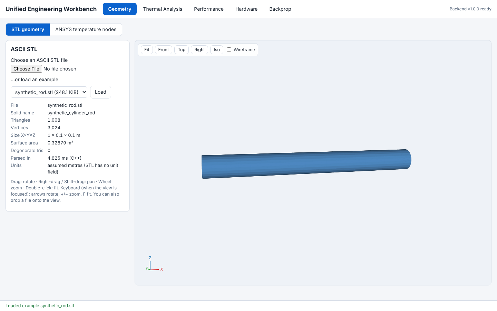 |
| 2 | 18:36:42 | Geometry: wireframe toggle | 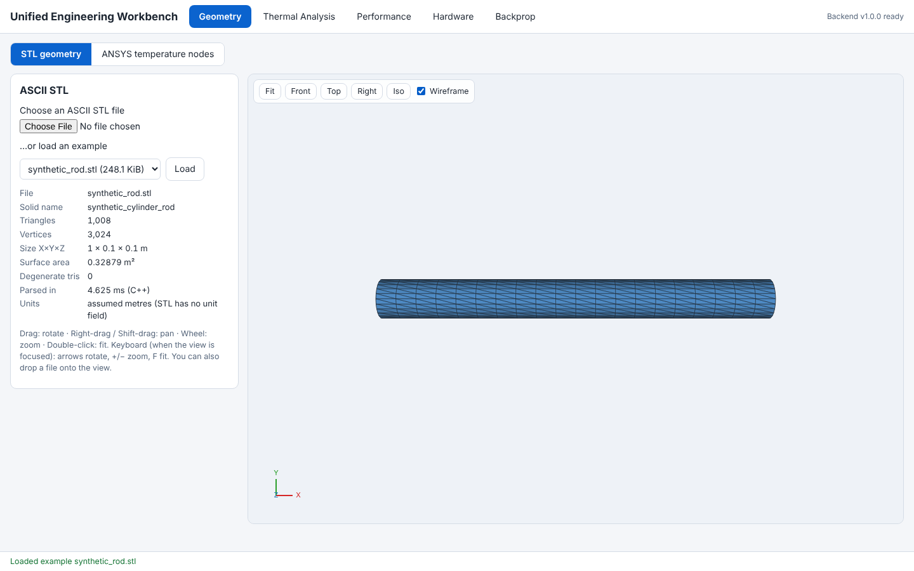 |
| 3 | 18:36:42 | Geometry: malformed/binary STL rejected with a clear message | 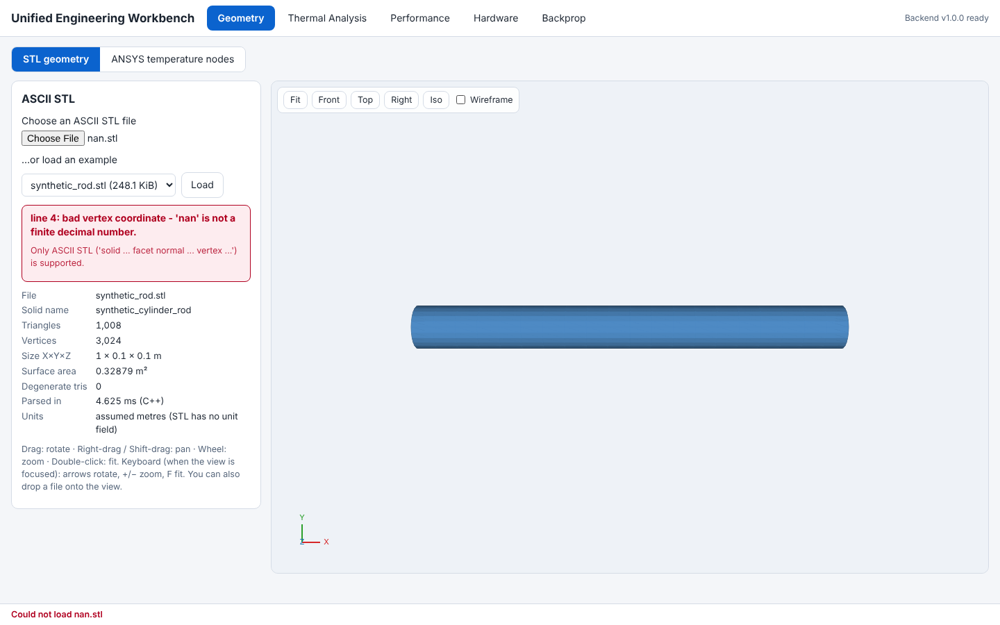 |
| 4 | 18:36:42 | Geometry: ANSYS-style CSV point cloud, colour legend, units, node inspection | 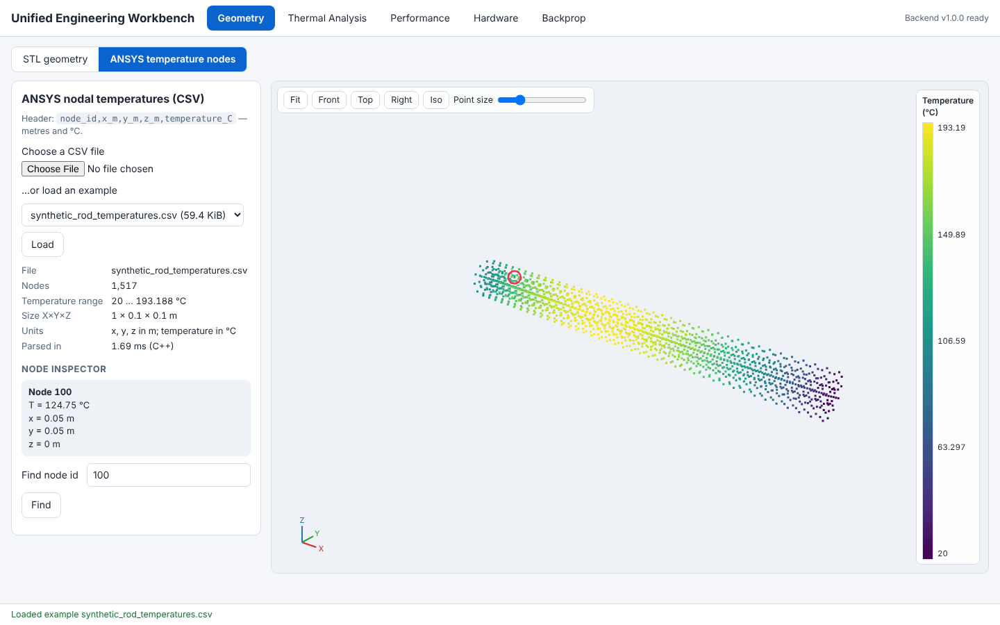 |
| 5 | 18:36:43 | Geometry: malformed CSV rejected with line numbers | 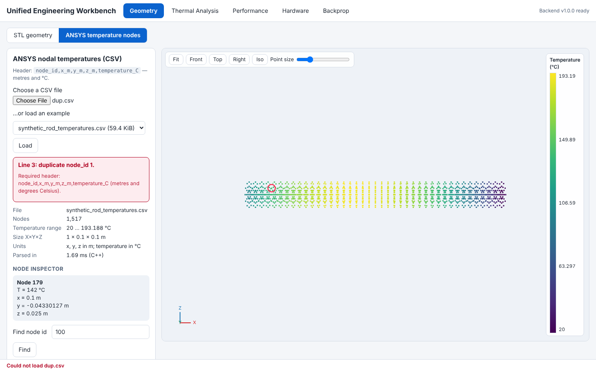 |
| 6 | 18:36:43 | Thermal: N=10/20/40/80, convergence, export | 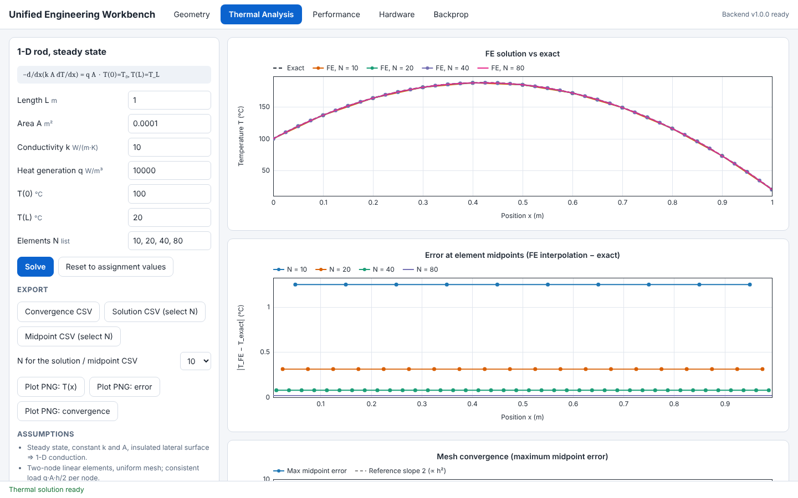 |
| 7 | 18:36:46 | Performance: serial vs pool, speedup/efficiency, environment | 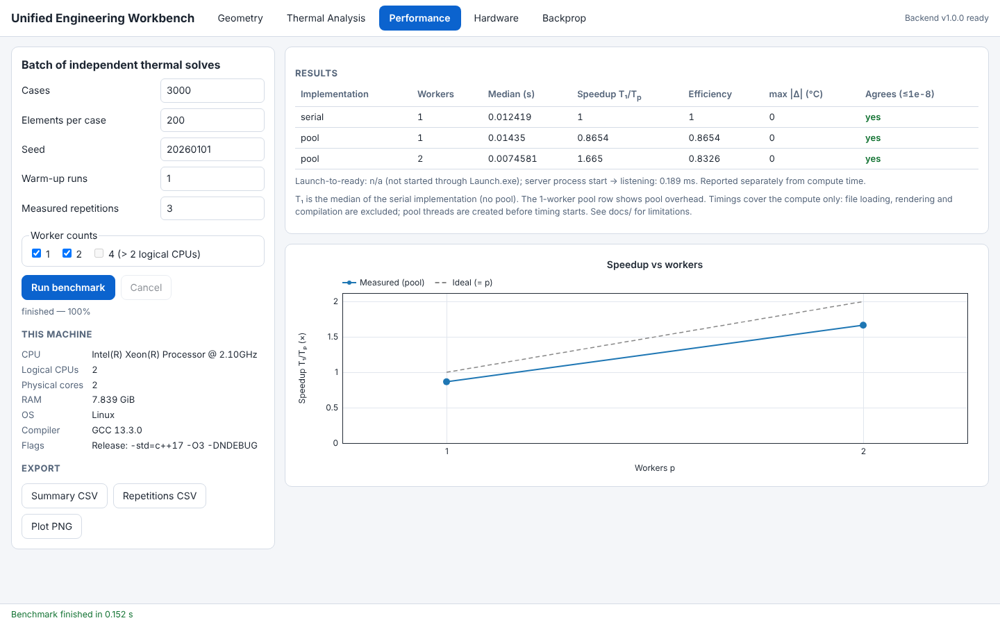 |
| 8 | 18:36:48 | Hardware (SIMULATED): injected timeout, recoverable error | 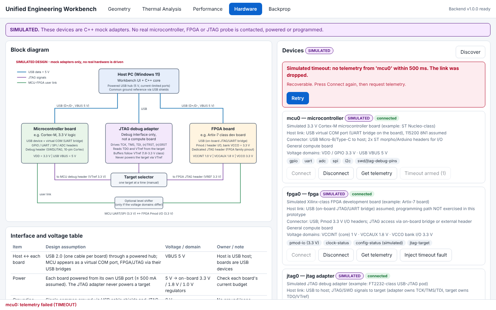 |
| 9 | 18:36:48 | Hardware (SIMULATED): reconnect after the timeout | 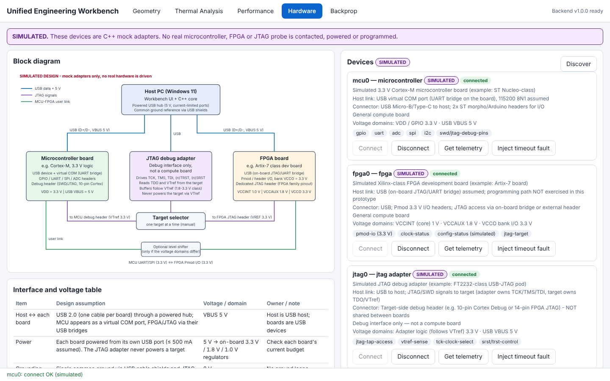 |
| 10 | 18:36:49 | Backprop: gradient check and loss plot | 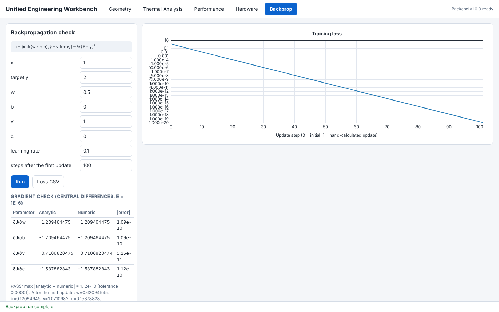 |
| 11 | 18:36:51 | Responsive layout (390 px) | 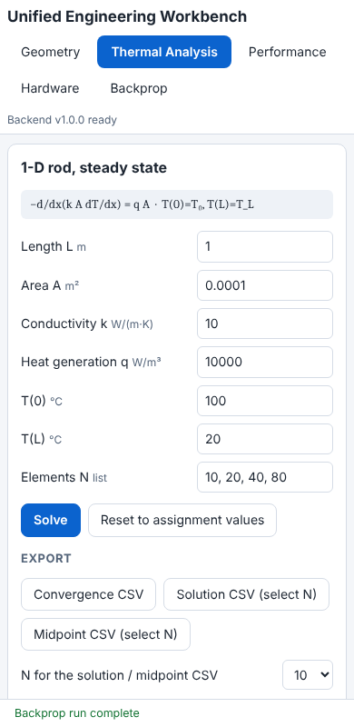 |
| 12 | 18:36:51 | Dark theme | 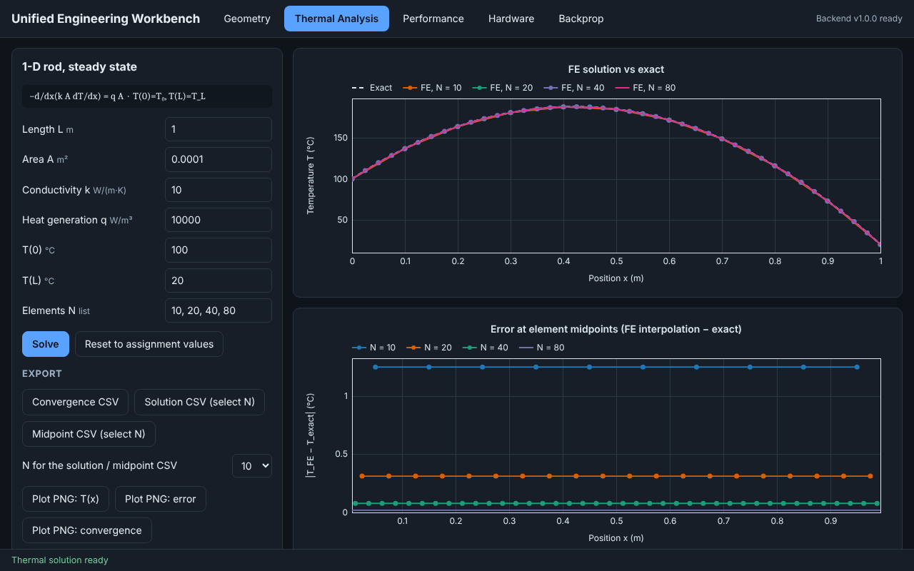 |
| 13 | 16:18:31 | Stress: 100,000-triangle STL | 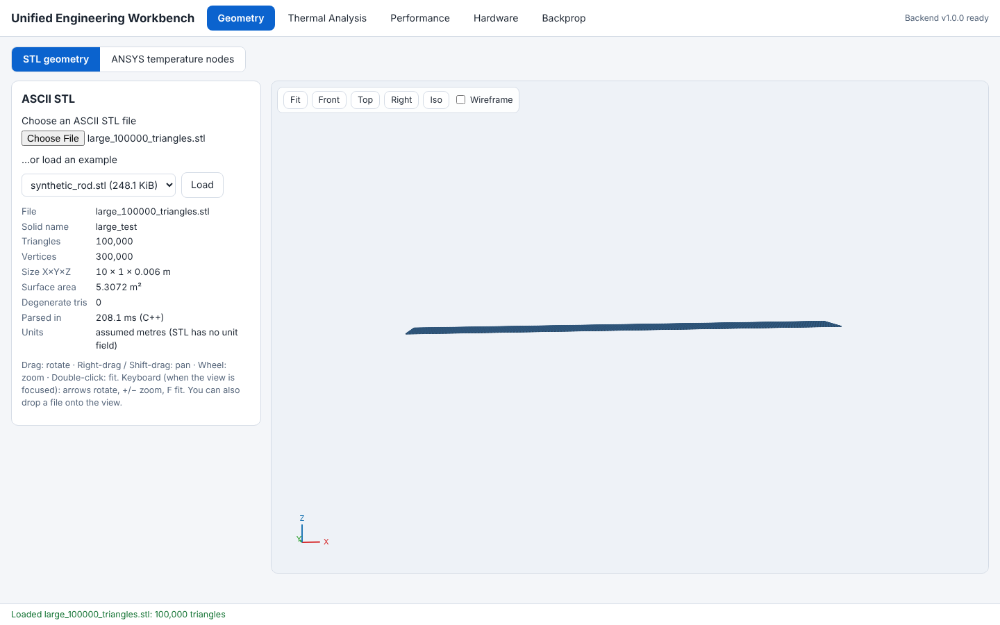 |
| 14 | 16:18:37 | Stress: 1,000,000-node CSV | 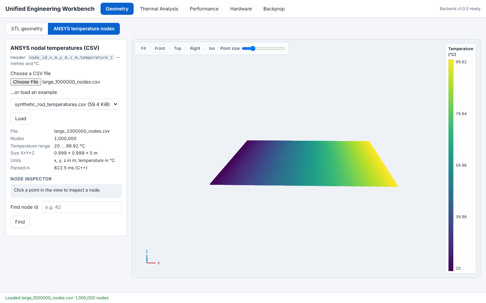 |

## Logs
* `results/ui_test.log` - UI end-to-end checks (all pass)
* `results/unit_test.log` - 70 C++ tests (0 failed)
* `results/mutation_check.log` - mutation check
* `results/performance_environment.txt`, `performance_summary.csv` - benchmark on the candidate's PC

```
e_c: 'nan' is not a finite decimal number (nan, inf, text and hex"
  ok   hdr.csv: error mentions 'header' -> "line 1: header column 1 is 'id' but must be 'node_id'. required header: node_id,x_m,y_m,z_"
  ok   empty.csv: error mentions 'empty' -> "the file is empty (0 bytes). export nodal temperatures with the header 'node_id,x_m,y_m,z_"
  ok   dup.csv: error mentions 'duplicate' -> 'line 3: duplicate node_id 1.\n\nrequired header: node_id,x_m,y_m,z_m,temperature_c (metres a'
Thermal
  ok   convergence table has N = 10,20,40,80
  ok   midpoint errors 1.25 ... 0.0195 (1.25, 0.0195312)
  ok   observed order ~2 (2)
  ok   invalid k shows an error
  ok   invalid field is marked aria-invalid
  ok   custom mesh list re-solves
  ok   convergence CSV downloads with header
  ok   solution CSV downloads
Performance
  ok   system information shown
  ok   UI stays responsive: run disabled, cancel enabled while running
  ok   serial + pool rows, all agree ([['serial', '1'], ['pool', '1'], ['pool', '2']])
  ok   cancel returns the UI to idle
  ok   invalid case count is rejected with a message
Hardware
  ok   three devices (MCU, FPGA, JTAG)
  ok   SIMULATED labels present
  ok   block diagram rendered
  ok   all three device types connect and report telemetry
  ok   timeout failure shown with actionable message and Retry
  ok   Retry recovers the device
Backprop
  ok   gradient check PASS
Accessibility / responsive
  ok   geometry: no horizontal page scroll at 390 px (390 vs 390)
  ok   thermal: no horizontal page scroll at 390 px (390 vs 390)
  ok   performance: no horizontal page scroll at 390 px (390 vs 390)
  ok   hardware: no horizontal page scroll at 390 px (390 vs 390)
  ok   backprop: no horizontal page scroll at 390 px (390 vs 390)
  ok   no console errors ([])

0 failure(s)
```
